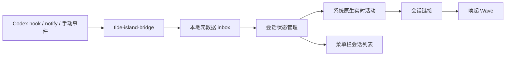

# TideIsland 架构

## 目标与范围

TideIsland 是连接开发会话与 Mac 系统原生实时活动的本地伴随应用。首版围绕 Wave + Codex，先推进生命周期事件、会话管理、终端适配及原生界面源码，原生编译、签名和真机验收统一安排在 macOS 27.3 正式环境可用后进行；额度与宠物作为后续增强。

已有 Codex 生命周期桥接 CLI；真实配置安装和原生真机验收尚未完成。

开发顺序、任务状态与验收清单统一维护在 [开发计划与进度](development-progress.md)。现有共享层检查和 CI 继续随开发执行，不替代后续原生统一验收。

## 数据链路

- `TideIslandCore` 使用 Foundation、CryptoKit 和 macOS 文件操作接口，不调用 AppKit、ActivityKit 或终端内部接口。
- `TideIslandBridge` 验证事件并按 UUID 独立原子落盘，避免多个 CLI 写入者互相截断。
- 应用监听目录变更后读取最近 256 个合法事件文件，不定时扫描整个系统或读取聊天历史。
- `SessionRegistry` 按线程隔离当前轮次、退役轮次、重复窗口与工具生命周期；明确的新轮开始才能切换已有轮次。同轮终态胜过迟到工作，注意力排序独立于事件处理优先级。
- 初始化的读取窗口是数量上限，不是磁盘保留策略；历史文件暂不自动删除，后续补充有界保留和会话存活检测。

## 事件协议 v1 / v2

| 字段 | 含义 |
| --- | --- |
| `version` | 读取 v1 / v2，新 CLI 输出 v2，未知版本拒绝处理 |
| `id` | UUID，事件身份及落盘文件名 |
| `sessionID` | 会话身份，不作为文件路径 |
| `projectName` | 显示名称，不保存完整 cwd |
| `phase` | v1 的 working / needsInput / completed / failed；v2 增加 interrupted / ended |
| `occurredAt` | ISO 8601 时间；本 Codex 适配器无上游时间字段，使用接收时间，按身份和状态规则处理顺序冲突 |
| `waveBlockID` | 可选的 Wave 分屏元数据，不包含认证凭据 |
| `context` | v2 必需：source / kind / receivedAt，可选源时间、turn 和工具身份；v1 保持缺失 |

每个标准化事件最多 16 KiB，hook 输入最多 1 MiB。不落盘 prompt、assistant reply、完整 cwd、工具输入输出、令牌或整个环境变量集合。Codex `agent-turn-complete` 被映射为本轮结束，不当作任务完成、测试通过或成功发布。

`hook` 入口只观察，stdout 为空，可捕获错误返回 0，许可决定继续留给 Codex。`Stop` 可能续跑、`SessionStart` 可能只是压缩恢复，因此当前忽略；带子代理标记的输入也不覆盖主会话。固定版本语义与待接入范围见 [Codex 事件契约](codex-events.md)。

## hooks 配置管理

`CodexHookConfiguration` 对有界 JSON 生成只包含 TideIsland 条目变更的计划；保留未知字段、数值字面量和其他命令，拒绝重复键。`HookConfigurationFile` 负责预览、指纹复核、文件锁、受限权限备份和原子发布。CLI 默认预览，显式应用才写文件。

配置管理只编辑指定的 `hooks.json`，保留 `config.toml` 中 notify、内联 hooks 和信任状态。专用分组正常升级时原地更新，卸载保留空分组，减少其他条目索引变化。文件安装与 Codex 信任审查、真实运行分别记录；完成 notify 的完整接入与共存仍由 T025 处理。命令、备份、并发边界和回退说明见 [hooks 配置管理](codex-hooks.md)。

## 确定性回放

`EventReplay` 用 fixture 提供的 UUID 与接收时钟调用真实适配器，经 `EventCodec` 编解码后送入独立 `SessionRegistry`，按声明的到达顺序比较每一步完整会话快照。CLI 的 `replay` 入口仅有界读取文件并输出稳定 JSON，不写 inbox 或 Codex 配置，不启动原生组件。

当前基线包含 24 个场景 / 116 步，覆盖生命周期、权限等待与恢复、中断、错误、非相邻重复、旧版本、跨轮、工具重排及会话隔离。T005 的跨轮迟到 notify 反例保留正确预期并迁入通过集合；其他 turn 的观察可有界暂存，显式开始后绑定回放。回放额外输出 `registryDecision` 与独立的跟踪 turnID，原始 context 保持观察语义。格式见 [事件回放](event-replay.md)，状态优先级、窗口和来源边界见 [会话状态](session-state.md)。

## 原生显示

原生目标最低 macOS 27.3，使用 ActivityKit + WidgetKit；系统负责灵动岛 / 菜单栏的展示和交互边界。应用和扩展共享同一 ActivityAttributes 声明，内容状态只传选中会话及聚合计数。

源码未采用自行绘制的 NSPanel 作为系统原生岛的替代。27.3 SDK 是原生编译的前提，27.3 系统是运行前提；27.2 环境只能验证共享层。源码与结构检查不能证明原生目标已编译或运行。

当前实时活动由会话更新触发，5 分钟后变为 stale 展示；没有工作中或待处理会话时结束 Activity，保留结束状态 30 秒。启动时不载入超过 15 分钟的事件。任务存活、历史清理、跨重启持久化与原生活动恢复仍待后续完善。

## Wave 接入

初始化只通过应用 bundle identifier 唤起 Wave。本机 Wave 0.14.5 提供 `wsh focusblock`，其帮助文本限定当前标签；真实调用还需要验证 Wave 上下文、认证、跨标签和窗口选择。保存 block ID 不等于已经实现精确跳转。

URL scheme 只识别 `tide-island://session?id=...`，只查找已有会话，不把链接参数拼接成 shell 命令。

## 验证边界

共享层测试覆盖协议、非法输入、隐私边界、重复 / 乱序事件、多会话隔离、URL 路由及损坏的 inbox 文件。工程结构检查核对文件成员、扩展嵌入和版本要求。

原生目标必须另行完成：支持 SDK 的无签名编译、签名安装、启动 / 更新 / 结束 Activity、点击唤起 Wave、触摸、多屏、睡眠恢复和其他系统活动共存。这些项目在初始化阶段未通过实机验收。
