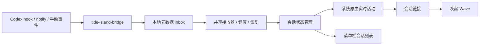

# TideIsland 架构

## 目标与范围

TideIsland 是连接开发会话与 Mac 系统原生实时活动的本地伴随应用。首版围绕 Wave + Codex，推进生命周期事件、会话管理、终端适配、系统原生活动和可选 Codex 额度。当前在 macOS 27.3 beta 验证，正式环境另行复验。

已有 Codex 生命周期桥接 CLI；已完成 beta 原生双配置、本机签名安装和前台合成 SDK 生命周期，用户演示已在原生岛显示。真实 Codex 配置已按授权安装，信任审查、真实会话及其他系统交互仍分别验收。

开发顺序、任务状态与验收清单统一维护在 [开发计划与进度](development-progress.md)。现有共享层检查和 CI 继续随开发执行，不替代后续原生统一验收。

## 数据链路

- `TideIslandCore` 使用 Foundation、CryptoKit 和 macOS 文件操作接口，不调用 AppKit、ActivityKit 或终端内部接口。
- `TideIslandBridge` 验证事件并按 UUID 独立原子落盘，避免多个 CLI 写入者互相截断。
- 共享 `InboxReceiver` actor 持有接收者锁、目录及父目录监听、游标、状态、重试与一次性过期任务；原生界面订阅最新帧，监听代次隔离旧回调。目录变更后增量读取有界候选，首批不再截断为 256 个文件；后续复用未变化正文，只扫描本地 inbox 元数据，不定时扫描系统或读取聊天历史。
- 健康来源的常规重确认同步核验后只发布最终帧，避免临时失去权威而触发界面闪变和活动结束 / 重建；真正的失效、错误与启动恢复仍即时发布，原观察新鲜度不变。权限查询保留上次结果直到当前请求完成，见 [故障恢复](inbox-recovery.md)和 [系统状态](system-status.md)。
- `SessionRegistry` 按线程隔离当前轮次、退役轮次、重复窗口与工具生命周期；明确的新轮开始才能切换已有轮次。同轮终态胜过迟到工作，注意力排序独立于事件处理优先级。
- `SessionStore` 同时检查当前目录是否仍能确认展示观察；通道异常或原记录缺失时暂停实时计数，保留原时间和偏好。在相同接收路径上调用时间投影：新鲜、待确认和展示过期独立于事件 phase；没有新观察不推断退出，不把重读时间作为新鲜度时钟。
- 已读 / 忽略绑定到用户看见的事件 ID，置顶和选择按会话保留。注意力策略输出列表理由和 Activity 候选；待处理优先，已读完成提醒降级，忽略记录有独立恢复入口。偏好只影响投影，不改写事件，由版本化元数据 checkpoint 跨重启保存。
- 会话窗口为选择摘要、活动候选和底部提示保留稳定区域，消息变化不挤压列表。原生模型仍逐帧保留诊断、来源确认与强制活动同步，只跳过相同提示 / 恢复标记 / 快照的重复界面发布；不以减少刷新为由隐藏通道错误或暂停真实状态更新，见 [会话浏览](session-browser.md)。
- 菜单栏弹出菜单只提供固定标题和操作入口，不直接订阅实时模型；操作仍调用当前模型，详细系统状态与进度由会话窗口和设置呈现，见 [系统状态](system-status.md)。
- 磁盘保留按整会话历史制定年龄 / 容量软目标，完整保护未结束和有归属疑点的事件链；默认只预览，显式应用通过指纹和协作锁核对、成功保存轮次 checkpoint 后清理，不在后台开始新的清理。已批准清理先发布恢复日志，接收器 / 写入者先恢复它，再接受完整历史；有效暂存事件可按原身份发布。

## 事件协议 v1 / v2

| 字段 | 含义 |
| --- | --- |
| `version` | 读取 v1 / v2，新 CLI 输出 v2，未知版本拒绝处理 |
| `id` | UUID，事件身份及落盘文件名 |
| `sessionID` | 会话身份，不作为文件路径 |
| `projectName` | 显示名称，不保存完整 cwd |
| `phase` | v1 的 working / needsInput / completed / failed；v2 增加 interrupted / ended |
| `occurredAt` | ISO 8601 时间；本 Codex 适配器无上游时间字段，使用接收时间，按身份和状态规则处理顺序冲突 |
| `waveBlockID` | 可选的 Wave 分屏元数据，不包含认证凭据 |
| `waveLocation` | v2 可选、内部 schema v1：完整 block 及可选 tab / workspace / window、版本、观察时间和来源；与旧 block 同时存在时必须一致 |
| `context` | v2 必需：source / kind / receivedAt，可选源时间、turn 和工具身份；v1 保持缺失 |

每个标准化事件最多 16 KiB，hook 输入最多 1 MiB。不落盘 prompt、assistant reply、完整 cwd、工具输入输出、令牌或整个环境变量集合。Codex `agent-turn-complete` 被映射为本轮结束，不当作任务完成、测试通过或成功发布。

`hook` 入口只观察，stdout 为空，可捕获错误返回 0，许可决定继续留给 Codex。`Stop` 可能续跑、`SessionStart` 可能只是压缩恢复，因此当前忽略；带子代理标记的输入也不覆盖主会话。固定版本语义与待接入范围见 [Codex 事件契约](codex-events.md)。

## Debug 原生验证模式

Debug 的 `--native-sdk-smoke` 与互斥的 `--native-sdk-smoke-background` 分别测试前台及菜单栏后台的合成 request / update / end / shutdown。应用委托延迟构造正常 SessionModel，三个 scene 的内容分支及退出分支均隔离正常接收器、显示偏好和提醒；后台模式保留诊断菜单项。测试始终 ownedOnly，按合成会话核对 SDK 清单，不接管遗留；输出模式、固定问题码及 SDK 授权错误的枚举 / 数字，失败也清理。Release 不读取参数或包含驱动。后台实测 visibility / 7 映射为共享 foregroundRequired，系统状态提供明确的窗口激活恢复动作；实际显示及用户点击仍分别验收，见 [生命周期测试范围](native-validation.md#显式-debug-sdk-生命周期测试)。

## hooks 配置管理

`CodexHookConfiguration` 对有界 JSON 生成只包含 TideIsland 条目变更的计划；保留未知字段、数值字面量和其他命令，拒绝重复键。`HookConfigurationFile` 负责预览、指纹复核、文件锁、受限权限备份和原子发布。CLI 默认预览，显式应用才写文件。

配置管理只编辑指定的 `hooks.json`，保留 `config.toml` 中 notify、内联 hooks 和信任状态。专用分组正常升级时原地更新，卸载保留空分组，减少其他条目索引变化。文件安装与 Codex 信任审查、真实运行分别记录；完成 notify 的完整接入与共存仍由 T025 处理。命令、备份、并发边界和回退说明见 [hooks 配置管理](codex-hooks.md)。

T024 的应用构建阶段按配置 / 架构生成 bridge，先处理 helper 签名，将可执行文件嵌入 Contents/Helpers、摘要清单和项目两份许可文本写入 Contents/Resources，外层应用由 Xcode 签署。Helpers 只含代码，嵌入脚本清除旧位置清单并拒绝输出链接，避免真实签名失败。归档检查许可文本及其摘要，独立 CLI ZIP 同样附带两份文本，发布清单分别记录资源与代码。BundledBridge 仍只读检查包元数据、路径和 helper 完整性；`hooks install --app` 将 helper 摘要 / 应用版本加入预览指纹，应用前重验，移动后只修复受管 handler。它不执行 helper 或替代系统签名验证；beta 双配置与本机签名已执行，真实运行见 [bridge 交付](bridge-delivery.md)及开发进度。

T025 的独立 notify 共存以共享 NotifyDispatchConfiguration 保留既有 argv 的明确边界和缺失 / 空数组恢复标记；TOMLNotifyDocument 只编辑顶层 notify 值，CodexNotifyConfiguration 绑定内容与 bundle 证据。NotifyConfigurationFile 实现私有原始备份、锁、指纹及发布前复核；notify-config 暴露显式预览 / 应用。内部 callback 先写必要元数据，再用 Process 转发原 argv / JSON，不使用 shell、正文存储或基于 payload cwd 的目录切换，两个结果互不阻断，详见 [完成 notify 共存](notify-integration.md)。

统一 integration 命令由 CodexIntegrationPlan 约束同目录、操作、bundle / inbox 及显式状态清除 scope，总指纹覆盖两个文件和状态预览。安装 hooks 后 notify，卸载顺序相反；数据默认保留，显式 clear-state 先按既有 lease / 导入边界清除会话状态，事件和应用显示偏好保留。各步骤独立发布，失败报告实际完成步骤及备份，不自动跨文件回滚，详见 [安装与卸载](installation.md)。

## 确定性回放

`EventReplay` 用 fixture 提供的 UUID 与接收时钟调用真实适配器，经 `EventCodec` 编解码后送入独立 `SessionRegistry`，按声明的到达顺序比较每一步完整会话快照。CLI 的 `replay` 入口仅有界读取文件并输出稳定 JSON，不写 inbox 或 Codex 配置，不启动原生组件。

当前生命周期基线包含 24 个场景 / 116 步，位置基线另有 3 个场景 / 7 步，覆盖生命周期、权限等待与恢复、中断、错误、非相邻重复、旧版本、跨轮、工具重排及会话隔离。T005 的跨轮迟到 notify 反例保留正确预期并迁入通过集合；其他 turn 的观察可有界暂存，显式开始后绑定回放。回放额外输出 `registryDecision` 与独立的跟踪 turnID，原始 context 保持观察语义。格式见 [事件回放](event-replay.md)，状态优先级、窗口和来源边界见 [会话状态](session-state.md)。

## 原生显示

原生目标最低 macOS 27.3，使用 ActivityKit + WidgetKit，系统负责灵动岛及菜单栏的展示和交互。应用和扩展共享同一 ActivityAttributes 声明，ContentState 别名到 IslandActivityContent，包含六个会话字段、可选额度和最多两条补充会话。T016 将时间投影、内容校验、基本自有活动控制和客户端协议移到共享层。共享 JSON 的 3 KiB 是开发预算，正式 SDK 传输限制仍待核对。详见 [实时活动展示与客户端](activity-presentation.md)。

源码未采用自行绘制的 NSPanel 作为系统原生岛的替代。27.3 SDK 是原生编译的前提，27.3 系统是运行前提；27.2 环境只能验证共享层。源码与结构检查不能证明原生目标已编译或运行。

原生源码通过共享 `SessionSnapshot` 计算列表与实时计数，仅新鲜的工作 / 待处理参与 Activity。截止时间取所有计数会话的最早新鲜度边界；应用挂起时，扩展按系统 stale 标记显示待确认。无新鲜活动时结束 Activity，T018 已加入完整清单协调与退出恢复。

启动恢复所有有界合法候选，不过滤 15 分钟前的记录：无更新工作 / 待处理保留为待确认，本轮终态展示保留 24 小时，退出记录保留 1 小时。展示过期本身不删除轮次状态或磁盘文件。时间边界使用一次性定时任务更新内存投影，激活 / 唤醒时增量读取与计算。规则与来源限制见 [会话存活与新鲜度](session-status.md)；文件管理标记、游标、资源预算、清理软目标与跨文件失败边界见 [inbox 维护](inbox-maintenance.md)。共享接收层已加入通道健康、重新监听、有限重试和中断操作恢复，见 [通道故障恢复](inbox-recovery.md)。T011 已加入完整元数据窗口 / 偏好及导入边界的有界 checkpoint，重启仍重扫当前来源；清理前先保存、主动清除同时保存抑制边界，规则见 [会话持久化](session-persistence.md)。可靠进程存活证据仍待后续实现。

T017 的共享 IslandActivityScheduler 接收源端单调序号，拒绝迟到提交，只保留一个最新 pending；SDK 操作串行，展示 / 截止相同则去重，普通变化按单调时钟作 1 秒开发限频，待处理增加或失去确认可打断等待。失败后的去重缓存视为不确定，只在新输入恢复；原生改为提交快照并订阅响应流，详见 [活动更新调度](activity-delivery.md)。这些间隔及共享预算不代表正式 SDK 限额或能耗已验收。

V011 已对 beta arm64 Release 的空闲进程采样 120 秒，记录 CPU、resident / physical footprint、唤醒计数及磁盘变化，见[资源基线](performance.md)。该结果只覆盖未接入真实事件的空闲条件，持续开发、多会话和能耗仍待实测。

T018 通过有界完整清单接管唯一活动、清理重复、响应授权及系统状态变化；只有健康主接收器可导入遗留活动，原生同时排除另一个运行实例。用户系统关闭后抑制相同展示的立即重建；强制同步保留源序号 / scope，退出拒绝新输入、等待进行中操作、在释放接收器前清理。未知清单完整保留，原生多实例 / 监听 / 退出仍待验证，详见 [活动生命周期](activity-lifecycle.md)。

27.3 beta SDK 的 Activity 句柄没有 Sendable 声明，异步 update / end 属于并发调用边界。原生客户端在 MainActor 保留归属及监听，只将 ID 与共享展示值传入非隔离的异步辅助方法，在调用域内重新取得 SDK 句柄并复核状态；不把 actor 字典中的句柄发送到该边界。缺失目标继续明确失败，shared scheduler 的串行、取消及重新协调规则保持。SDK 新增 pending 显式映射为共享 unknown，保留保守处理。前台合成 SDK 创建 / 同 ID 更新 / 结束 / shutdown 已实测通过，后台新建仍受 visibility 限制；真实来源与其他系统场景另验。

T019 的 IslandActivityViewState 为系统活动、expanded、compact 和 minimal 统一生成状态、符号、分类计数、会话链接和读屏文案。stale 隐去实时计数，compact 显示有界总数。expanded 将整个面板置于 bottom 区域，与系统活动主视图共享布局。图标、项目名和状态在上排，计数与标准 Link 在下排。可用宽度或高度收紧时，SwiftUI 选择合适的排法，保留完整读屏文案。详见 [活动视图](activity-views.md)。

多会话面板按现有注意力顺序显示近期确认的会话，每条记录有独立 Link。一个活动承载有界的预览与完整计数。详见 [多会话总览](activity-views.md#多会话总览)。

会话窗口由单个 SwiftUI Window 场景提供，菜单栏负责重开。菜单操作使用固定 Label，并以 `.titleAndIcon` 请求显示普通菜单图标。应用委托让关闭最后一个窗口后继续接收事件和维护活动，主动退出进入同一个异步清理流程。见 [活动生命周期](activity-lifecycle.md#正常退出)。

启用额度后，应用短时连接同一用户的本机 Codex App Server 控制 socket，调用只读 `account/rateLimits/read`，从 Codex 额度桶提取有界的窗口、剩余量和重置时间。认证由已有进程处理，应用只传递必要的额度元数据。额度随来源序号提交并独立计算有效期。会话原观察时间、聚合及 stale 截止继续由事件决定。见 [Codex App Server](https://learn.chatgpt.com/docs/app-server#6-rate-limits-chatgpt)和[额度设置](preferences.md#codex-额度)。

原生列表源码已加入已读、忽略、置顶和选择。Activity 候选始终优先新鲜待处理，随后才使用选择或置顶的新鲜工作；忽略及历史记录不参与实时聚合。相同注意力策略供共享层测试和原生接入使用，详细操作一致性、稳定排序与恢复语义见 [会话注意力规则](session-attention.md)。beta 原生已编译，实际交互仍待验证。

## 会话提醒

T020 的共享 SessionReminderCoordinator 以同一源端序号接收快照 / 设置 / 主范围，启动建立基线，同 phase / 已知 turn 的连续周期只提醒一次；需要确认来源、未读、未忽略和新鲜期限，安静时段使用当前当地 Calendar。独立可信查看证据才可抑制同一会话，当前没有真实前台 block driver，原生传 nil。

权限 await 后使用最新元数据与期限再判断；通知结果不明时不自动重复 post 同一周期，后续新周期可恢复。默认关闭，不在初始化申请权限；UserNotifications 源码只携带项目名、固定标题与会话链接，点击重用当前观察返回流程。提醒与 Activity 均停止后再释放接收器，原生效果待验证；规则见 [会话提醒](session-reminders.md)，T021 已加入 [设置入口与主动授权](preferences.md)。

## 偏好与设置

T021 以有界 version 1 的 AppPreferences envelope 分开保存应用偏好，读取失败保留原记录并阻止普通覆盖。默认提醒 / 声音关闭，项目名开启，历史界面显示 24 小时；设置窗口支持主动通知授权、安静时段、项目名称、1 / 6 / 24 小时显示及公开 ServiceManagement 登录启动。

显示名按来源序号随活动快照传递，SDK 负载与提醒都应用同一选择；系统关闭记忆忽略显示名变更。历史仅过滤界面已解决状态，未确认状态和来源时间不变；系统时间线复核显示，不轮询来源或触发清理。OS 权限 / 登录操作只由明确用户动作发起，保存意图与实际系统状态分开。原生组件 / 系统效果待验收，详见 [偏好设置](preferences.md)。

## 最近元数据查询

T022 的 `InboxReceiver.metadataHistory` 只读当前来源缓存，要求健康通道和当前完整引用；候选同时属于现有 512 UUID 窗口 / 当前锚点，默认返回 8、最多 20 条必要元数据。查询不重读文件、重放事件、确认已读或开始清理；重启沿用 checkpoint 窗口，清除前的抑制文件不会成为新会话历史。观察排序不代表全部已应用或因果先后，详见 [最近元数据](session-metadata-history.md)。T022 已通过 [会话浏览](session-browser.md)源码接入项目筛选、只读详情及空状态恢复。

T022 的 SessionBrowserProjection 以显示偏好和原快照生成按名称分组、匿名选择 ID、过滤列表 / 计数与空状态。浏览不改变全局选择、已读或岛上候选；详情绑定原引用，元数据返回后复核最新来源 / 引用并用请求代次隔离晚结果，状态变化后由用户重新查看当前观察。原生辅助视图沿用既有文件，交互效果待验证。

## 系统状态与恢复入口

T023 的 SystemStatusProjection 分开呈现实时活动能力、独立通知权限、来源确认、上次交付错误及登录批准。系统允许不证明原生岛 / 横幅已显示，多个错误同时保留；原生通过公开权限查询及请求代次隔离迟到读取。重新检查沿用接收器、源序号和活动所有权协调，不重发旧提醒或解除关闭记忆；菜单栏和只读设置外的恢复入口保持可用。原生效果待 27.3，详见 [系统能力与错误](system-status.md)。

## Wave 接入

当前源码只通过 bundle identifier 唤起 Wave。T012 已核对本机 0.14.5 与固定版本源码：`wsh focusblock` 要求 Wave 认证及 tab 上下文，只聚焦标签内布局，不激活其他标签 / 窗口；内部 Electron / HTTP 切换服务不作为稳定第三方接口。公开列表还存在部分失败、非 JSON 空结果和字段差异，元数据只能有界提取 ID。版本、证据和 T013—T015 的实施边界见 [Wave 定位能力](wave-capabilities.md)。T013 已接入可选位置、严格 allowlist、独立有效期和有界列表解析；位置仅随当前已应用观察变化，来源不能确认时降为待确认，过期不改变生命周期。checkpoint 写 v2 并兼容旧 v1，原始输出与凭据不进入持久化。具体字段和迁移见 [Wave 位置元数据](wave-location.md)。解析器不执行 wsh，T014 已增加共享路线策略及可注入编排器：使用原观察身份、近期已认证连接和完整目标复核后，才请求同标签布局聚焦；并发、取消和异常保留实际尝试路线。默认没有 driver，返回应用级回退建议；聚焦响应不证明可见定位，也未接入真实执行。详细契约见 [定位路线与结果](wave-navigation.md)。

T015 用共享 `WaveReturnCoordinator` 组合导航结果和应用打开请求，重新核对原观察后查询安装 / 运行状态；未安装、打开失败、旧行、并发和取消分别反馈。原生 NSWorkspace driver 只查固定 bundle identifier 并请求打开，不传会话参数或读取认证数据。结果保留实际尝试路线，应用请求和聚焦响应均不证明可见精确定位，详见 [应用级返回](wave-return.md)。

URL scheme 只识别 `tide-island://session?id=...`；ID / URL 有界，拒绝控制字符、fragment、重复 / 未知字段，只解析当前唯一可见观察，失败显示明确提示。不把链接参数拼接成 shell 命令。

## 验证边界

T028 的 DiagnosticReport 只投影版本、时间、汇总与固定原因，事件 / session / navigation reference 不进入报告。CLI 默认版本模式，仅显式 inbox 才以现有完整有界读取生成离线清单，不创建 receiver / checkpoint 或重放 reset 抑制历史。应用在每次 publish 去重前缓存帧及接收时间，Wave 实际返回先去身份再保留单次观察；管理菜单仅在用户动作时组装共享 live 报告、读取系统缓存并打开保存面板，创建数据根之外的私有新文件。诊断不重连、不上传、不证明原生运行，详见 [诊断与回放](diagnostics.md)。

T026 从 VERSION.json 生成 Xcode / 共享 CLI 版本，应用与扩展记录归档 source revision；显式构建脚本先核对环境，再准备原生 archive、签名后 helper 清单、应用 / CLI ZIP 和无绝对路径的摘要记录。签名方式、可选公证、归档头部检查及 checksum 校验分别记录，产物元数据不证明原生运行。当前已有 beta 本机 archive / ad hoc 包和安装证据，Developer ID / 公证仍待验，详见 [版本与打包](packaging.md)及[进度台账](development-progress.md)。

T027 提供默认不运行的 workflow_dispatch 原生流水线与明确正式环境的执行脚本，绑定完整 reviewed SHA / clean source、真实环境数字检查及逐配置结果。Debug / Release 编译前后复核源，artifact / CLI version 检查与运行验收分离；共享 CI 只检查入口和来源保护，不调用 native tools。实际 runner / 构建未调度，详见 [原生验证入口](native-validation.md)。

V001 新增只读 `native_environment.py`，通过四个固定版本查询分别报告 host / Xcode / SDK 与全部可确认问题，不保存原始工具错误，不接受许可或修改系统。独立调用无需源码 / 发行渠道声明；实际 native-validation 先要求互斥的正式或 prerelease 声明与精确 clean source，再复用预检。V002 本地 beta 验证明确输出 validation_channel 与两项互斥声明，保留同一版本 / 来源 / 输出和逐配置证据；手动 native workflow 仍只允许正式环境。数字条件就绪与 release_channel 未核验分别记录，不能据此宣称正式环境或编译 / 运行通过，见 [环境与公开 API 初核](native-validation.md#只读环境预检)。

T029 将平台目标、已审阅外部契约和实际测试环境集中在 [兼容清单](compatibility.md)。事件、位置、checkpoint、显示设置、配置 wrapper 与发布清单分开版本化；未知格式失败保留、只读加载不迁移、必要保存才更新及降级限制见 [迁移说明](migrations.md)。[许可清单](../THIRD_PARTY_NOTICES.md)区分当前无第三方 package 的源码与系统 / 外部 / CI 环境，实际二进制内含库留待归档验收。

T030 的 [首次使用](getting-started.md)按当前共享开发和后续正式环境区分操作；[FAQ](faq.md)以现有菜单 / 设置、来源语义、配置与数据保留范围为准。安装命令继续集中在 [统一接入](installation.md)，文档不把演示事件、离线文件、系统允许、checksum 或请求响应当作真实端到端 / 可见原生结果。

T031 [固定 app-server 研究](app-server-research.md)确认有结构化 isBlocking 请求和最终 turn.status；线程 pending flag 可含非阻塞问题，resume 会 rejoin / 冷加载并回放有响应能力的请求，不能直接作为无干扰旁观接口。当前 source / kind、采集器和 capability 保持现有范围；后续只有明确宿主来源及身份 / 权威 / 生命周期与隐私契约经隔离证明后才考虑适配，不连接真实会话取证。

共享层测试覆盖协议、非法输入、隐私边界、重复 / 乱序事件、多会话隔离、URL 路由及损坏的 inbox 文件。工程结构检查核对文件成员、扩展嵌入和版本要求。

共享 CI 与本机验证使用同一 `swift_test_summary.py` 解析实际测试摘要，兼容旧格式与 Swift 6.4 新增的 suites 字段；保留 Swift 原退出码、正向实际执行数和完整声明数量守卫，不把 XCTest 的零测试输出记为已验收。解析兼容由独立正向 / 零测试 / 少跑 / 失败摘要 fixture 核对。

原生目标必须另行完成：支持 SDK 的无签名编译、签名安装、启动 / 更新 / 结束 Activity、点击唤起 Wave、触摸、多屏、睡眠恢复和其他系统活动共存。这些项目在初始化阶段未通过实机验收。
