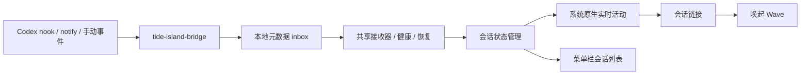

# TideIsland 架构

## 目标与范围

TideIsland 是连接开发会话与 Mac 系统原生实时活动的本地伴随应用。首版围绕 Wave + Codex，先推进生命周期事件、会话管理、终端适配及原生界面源码，原生编译、签名和真机验收统一安排在 macOS 27.3 正式环境可用后进行；额度与宠物作为后续增强。

已有 Codex 生命周期桥接 CLI；真实配置安装和原生真机验收尚未完成。

开发顺序、任务状态与验收清单统一维护在 [开发计划与进度](development-progress.md)。现有共享层检查和 CI 继续随开发执行，不替代后续原生统一验收。

## 数据链路

- `TideIslandCore` 使用 Foundation、CryptoKit 和 macOS 文件操作接口，不调用 AppKit、ActivityKit 或终端内部接口。
- `TideIslandBridge` 验证事件并按 UUID 独立原子落盘，避免多个 CLI 写入者互相截断。
- 共享 `InboxReceiver` actor 持有接收者锁、目录及父目录监听、游标、状态、重试与一次性过期任务；原生界面订阅最新帧，监听代次隔离旧回调。目录变更后增量读取有界候选，首批不再截断为 256 个文件；后续复用未变化正文，只扫描本地 inbox 元数据，不定时扫描系统或读取聊天历史。
- `SessionRegistry` 按线程隔离当前轮次、退役轮次、重复窗口与工具生命周期；明确的新轮开始才能切换已有轮次。同轮终态胜过迟到工作，注意力排序独立于事件处理优先级。
- `SessionStore` 同时检查当前目录是否仍能确认展示观察；通道异常或原记录缺失时暂停实时计数，保留原时间和偏好。在相同接收路径上调用时间投影：新鲜、待确认和展示过期独立于事件 phase；没有新观察不推断退出，不把重读时间作为新鲜度时钟。
- 已读 / 忽略绑定到用户看见的事件 ID，置顶和选择按会话保留。注意力策略输出列表理由和 Activity 候选；待处理优先，已读完成提醒降级，忽略记录有独立恢复入口。偏好只影响投影，不改写事件，由版本化元数据 checkpoint 跨重启保存。
- 磁盘保留按整会话历史制定年龄 / 容量软目标，完整保护未结束和有归属疑点的事件链；默认只预览，显式应用通过指纹和协作锁核对、成功保存轮次 checkpoint 后清理，不在后台开始新的清理。已批准清理先发布恢复日志，接收器 / 写入者先恢复它，再接受完整历史；有效暂存事件可按原身份发布。

## 事件协议 v1 / v2

| 字段 | 含义 |
| --- | --- |
| `version` | 读取 v1 / v2，新 CLI 输出 v2，未知版本拒绝处理 |
| `id` | UUID，事件身份及落盘文件名 |
| `sessionID` | 会话身份，不作为文件路径 |
| `projectName` | 显示名称，不保存完整 cwd |
| `phase` | v1 的 working / needsInput / completed / failed；v2 增加 interrupted / ended |
| `occurredAt` | ISO 8601 时间；本 Codex 适配器无上游时间字段，使用接收时间，按身份和状态规则处理顺序冲突 |
| `waveBlockID` | 可选的 Wave 分屏元数据，不包含认证凭据 |
| `waveLocation` | v2 可选、内部 schema v1：完整 block 及可选 tab / workspace / window、版本、观察时间和来源；与旧 block 同时存在时必须一致 |
| `context` | v2 必需：source / kind / receivedAt，可选源时间、turn 和工具身份；v1 保持缺失 |

每个标准化事件最多 16 KiB，hook 输入最多 1 MiB。不落盘 prompt、assistant reply、完整 cwd、工具输入输出、令牌或整个环境变量集合。Codex `agent-turn-complete` 被映射为本轮结束，不当作任务完成、测试通过或成功发布。

`hook` 入口只观察，stdout 为空，可捕获错误返回 0，许可决定继续留给 Codex。`Stop` 可能续跑、`SessionStart` 可能只是压缩恢复，因此当前忽略；带子代理标记的输入也不覆盖主会话。固定版本语义与待接入范围见 [Codex 事件契约](codex-events.md)。

## hooks 配置管理

`CodexHookConfiguration` 对有界 JSON 生成只包含 TideIsland 条目变更的计划；保留未知字段、数值字面量和其他命令，拒绝重复键。`HookConfigurationFile` 负责预览、指纹复核、文件锁、受限权限备份和原子发布。CLI 默认预览，显式应用才写文件。

配置管理只编辑指定的 `hooks.json`，保留 `config.toml` 中 notify、内联 hooks 和信任状态。专用分组正常升级时原地更新，卸载保留空分组，减少其他条目索引变化。文件安装与 Codex 信任审查、真实运行分别记录；完成 notify 的完整接入与共存仍由 T025 处理。命令、备份、并发边界和回退说明见 [hooks 配置管理](codex-hooks.md)。

## 确定性回放

`EventReplay` 用 fixture 提供的 UUID 与接收时钟调用真实适配器，经 `EventCodec` 编解码后送入独立 `SessionRegistry`，按声明的到达顺序比较每一步完整会话快照。CLI 的 `replay` 入口仅有界读取文件并输出稳定 JSON，不写 inbox 或 Codex 配置，不启动原生组件。

当前生命周期基线包含 24 个场景 / 116 步，位置基线另有 3 个场景 / 7 步，覆盖生命周期、权限等待与恢复、中断、错误、非相邻重复、旧版本、跨轮、工具重排及会话隔离。T005 的跨轮迟到 notify 反例保留正确预期并迁入通过集合；其他 turn 的观察可有界暂存，显式开始后绑定回放。回放额外输出 `registryDecision` 与独立的跟踪 turnID，原始 context 保持观察语义。格式见 [事件回放](event-replay.md)，状态优先级、窗口和来源边界见 [会话状态](session-state.md)。

## 原生显示

原生目标最低 macOS 27.3，使用 ActivityKit + WidgetKit；系统负责灵动岛 / 菜单栏的展示和交互边界。应用和扩展共享同一 ActivityAttributes 声明；ContentState 别名到共享 IslandActivityContent，延续六字段元数据。T016 将时间投影、内容校验、基本自有活动控制和客户端协议移到共享层，原生适配只调用 SDK。共享 JSON 的 3 KiB 是开发预算，正式 SDK 传输限制仍待核对；详见 [实时活动展示与客户端](activity-presentation.md)。

源码未采用自行绘制的 NSPanel 作为系统原生岛的替代。27.3 SDK 是原生编译的前提，27.3 系统是运行前提；27.2 环境只能验证共享层。源码与结构检查不能证明原生目标已编译或运行。

原生源码通过共享 `SessionSnapshot` 计算列表与实时计数，仅新鲜的工作 / 待处理参与 Activity。截止时间取所有计数会话的最早新鲜度边界；应用挂起时，扩展按系统 stale 标记显示待确认。无新鲜活动时结束 Activity，T018 已加入完整清单协调与退出恢复。

启动恢复所有有界合法候选，不过滤 15 分钟前的记录：无更新工作 / 待处理保留为待确认，本轮终态展示保留 24 小时，退出记录保留 1 小时。展示过期本身不删除轮次状态或磁盘文件。时间边界使用一次性定时任务更新内存投影，激活 / 唤醒时增量读取与计算。规则与来源限制见 [会话存活与新鲜度](session-status.md)；文件管理标记、游标、资源预算、清理软目标与跨文件失败边界见 [inbox 维护](inbox-maintenance.md)。共享接收层已加入通道健康、重新监听、有限重试和中断操作恢复，见 [通道故障恢复](inbox-recovery.md)。T011 已加入完整元数据窗口 / 偏好及导入边界的有界 checkpoint，重启仍重扫当前来源；清理前先保存、主动清除同时保存抑制边界，规则见 [会话持久化](session-persistence.md)。可靠进程存活证据仍待后续实现。

T017 的共享 IslandActivityScheduler 接收源端单调序号，拒绝迟到提交，只保留一个最新 pending；SDK 操作串行，展示 / 截止相同则去重，普通变化按单调时钟作 1 秒开发限频，待处理增加或失去确认可打断等待。失败后的去重缓存视为不确定，只在新输入恢复；原生改为提交快照并订阅响应流，详见 [活动更新调度](activity-delivery.md)。这些间隔及共享预算不代表正式 SDK 限额或能耗已验收。

T018 通过有界完整清单接管唯一活动、清理重复、响应授权及系统状态变化；只有健康主接收器可导入遗留活动，原生同时排除另一个运行实例。用户系统关闭后抑制相同展示的立即重建；强制同步保留源序号 / scope，退出拒绝新输入、等待进行中操作、在释放接收器前清理。未知清单完整保留，原生多实例 / 监听 / 退出仍待验证，详见 [活动生命周期](activity-lifecycle.md)。

T019 的 IslandActivityViewState 为系统活动 / expanded / compact / minimal 统一生成状态、符号、分类计数、会话链接和完整读屏文案；stale 隐去实时计数，compact 只在视觉上将大总数缩为 99+。原生采用可换行 / 省略项目名、计数分行回退及同一目标的标准 Link，不增加 wire 字段或改变会话优先级；无障碍、窄布局和输入效果待实测，详见 [活动视图](activity-views.md)。

原生列表源码已加入已读、忽略、置顶和选择。Activity 候选始终优先新鲜待处理，随后才使用选择或置顶的新鲜工作；忽略及历史记录不参与实时聚合。相同注意力策略供共享层测试和原生接入使用，详细操作一致性、稳定排序与恢复语义见 [会话注意力规则](session-attention.md)。原生交互仍未编译或实测。

## 会话提醒

T020 的共享 SessionReminderCoordinator 以同一源端序号接收快照 / 设置 / 主范围，启动建立基线，同 phase / 已知 turn 的连续周期只提醒一次；需要确认来源、未读、未忽略和新鲜期限，安静时段使用当前当地 Calendar。独立可信查看证据才可抑制同一会话，当前没有真实前台 block driver，原生传 nil。

权限 await 后使用最新元数据与期限再判断；通知结果不明时不自动重复 post 同一周期，后续新周期可恢复。默认关闭，不在初始化申请权限；UserNotifications 源码只携带项目名、固定标题与会话链接，点击重用当前观察返回流程。提醒与 Activity 均停止后再释放接收器，原生效果待验证；规则见 [会话提醒](session-reminders.md)，T021 已加入 [设置入口与主动授权](preferences.md)。

## 偏好与设置

T021 以有界 version 1 的 AppPreferences envelope 分开保存应用偏好，读取失败保留原记录并阻止普通覆盖。默认提醒 / 声音关闭，项目名开启，历史界面显示 24 小时；设置窗口支持主动通知授权、安静时段、项目名称、1 / 6 / 24 小时显示及公开 ServiceManagement 登录启动。

显示名按来源序号随活动快照传递，SDK 负载与提醒都应用同一选择；系统关闭记忆忽略显示名变更。历史仅过滤界面已解决状态，未确认状态和来源时间不变；系统时间线复核显示，不轮询来源或触发清理。OS 权限 / 登录操作只由明确用户动作发起，保存意图与实际系统状态分开。原生组件 / 系统效果待验收，详见 [偏好设置](preferences.md)。

## Wave 接入

当前源码只通过 bundle identifier 唤起 Wave。T012 已核对本机 0.14.5 与固定版本源码：`wsh focusblock` 要求 Wave 认证及 tab 上下文，只聚焦标签内布局，不激活其他标签 / 窗口；内部 Electron / HTTP 切换服务不作为稳定第三方接口。公开列表还存在部分失败、非 JSON 空结果和字段差异，元数据只能有界提取 ID。版本、证据和 T013—T015 的实施边界见 [Wave 定位能力](wave-capabilities.md)。T013 已接入可选位置、严格 allowlist、独立有效期和有界列表解析；位置仅随当前已应用观察变化，来源不能确认时降为待确认，过期不改变生命周期。checkpoint 写 v2 并兼容旧 v1，原始输出与凭据不进入持久化。具体字段和迁移见 [Wave 位置元数据](wave-location.md)。解析器不执行 wsh，T014 已增加共享路线策略及可注入编排器：使用原观察身份、近期已认证连接和完整目标复核后，才请求同标签布局聚焦；并发、取消和异常保留实际尝试路线。默认没有 driver，返回应用级回退建议；聚焦响应不证明可见定位，也未接入真实执行。详细契约见 [定位路线与结果](wave-navigation.md)。

T015 用共享 `WaveReturnCoordinator` 组合导航结果和应用打开请求，重新核对原观察后查询安装 / 运行状态；未安装、打开失败、旧行、并发和取消分别反馈。原生 NSWorkspace driver 只查固定 bundle identifier 并请求打开，不传会话参数或读取认证数据。结果保留实际尝试路线，应用请求和聚焦响应均不证明可见精确定位，详见 [应用级返回](wave-return.md)。

URL scheme 只识别 `tide-island://session?id=...`；ID / URL 有界，拒绝控制字符、fragment、重复 / 未知字段，只解析当前唯一可见观察，失败显示明确提示。不把链接参数拼接成 shell 命令。

## 验证边界

共享层测试覆盖协议、非法输入、隐私边界、重复 / 乱序事件、多会话隔离、URL 路由及损坏的 inbox 文件。工程结构检查核对文件成员、扩展嵌入和版本要求。

原生目标必须另行完成：支持 SDK 的无签名编译、签名安装、启动 / 更新 / 结束 Activity、点击唤起 Wave、触摸、多屏、睡眠恢复和其他系统活动共存。这些项目在初始化阶段未通过实机验收。
